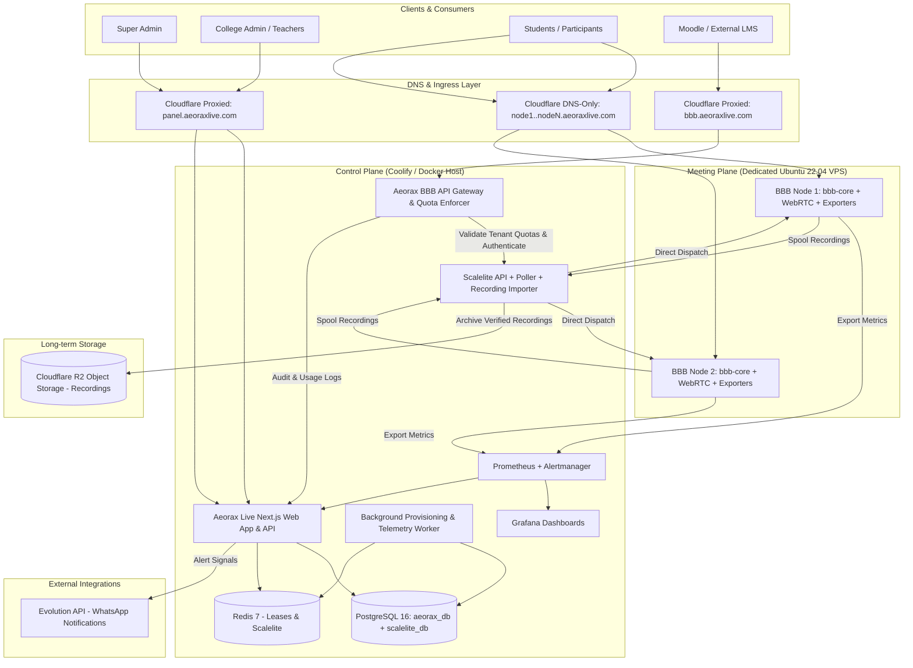

# Aeorax Live — System Architecture

**Platform**: Aeorax Live  
**Target Domain**: `aeoraxlive.com` (Control: `panel.aeoraxlive.com`, Gateway: `bbb.aeoraxlive.com`, Nodes: `nodeX.aeoraxlive.com`)  
**Architecture Date**: 2026-10-18  

---

## 1. System Topology Overview

Aeorax Live decouples the **Control Plane** (multi-tenant management, quotas, orchestration, API gateway, telemetry) from the **Meeting Plane** (dedicated Linux bare-metal or high-performance VPS nodes running BigBlueButton):

---

## 2. Component Boundaries & Responsibilities

### A. Aeorax Control Plane App & API Gateway
- **Stack**: Next.js 15 (App Router), TypeScript, Tailwind CSS, Prisma ORM.
- **Tenant Isolation**: Every database entity (User, Room, Session, Recording, Quota) strictly references `collegeId`. Every query enforces tenant boundary verification.
- **Quota Engine**: Real-time atomic reservations in Redis. When a meeting creation request arrives (via panel or Moodle), the gateway checks:
  1. Active concurrent meetings for college < `maxConcurrentRooms`.
  2. Room participant limit < `maxParticipantsPerRoom`.
  3. Total active participants across college < `maxTotalParticipants`.
- **Moodle Compatible Gateway (`bbb.aeoraxlive.com`)**:
  - Exposes standard BigBlueButton API (`/bigbluebutton/api/*`).
  - Moodle connects with college-specific credentials (tenant API key & secret).
  - Gateway validates tenant secret, acquires tenant quota lease, rewrites meeting ID with tenant prefix (`[college_slug]_[room_id]`), and proxies downstream to Scalelite with the master secret.
  - Master Scalelite secret is NEVER exposed to colleges or LMS integrations.

### B. Meeting Plane (BigBlueButton Nodes)
- **OS**: Ubuntu 22.04 LTS (Jammy Jellyfish).
- **BBB Version**: 3.0.39 (Official stable release).
- **Network Requirements**:
  - Dedicated public IPv4 address.
  - DNS-only record (no Cloudflare proxy) to prevent WebRTC UDP stream degradation and WebSocket termination issues.
  - Inbound ports: TCP 80, 443; UDP 16384–32768 (RTP/WebRTC audio & video).
- **Node Exporters**:
  - Prometheus `node_exporter` (system metrics: CPU, memory, network, I/O, steal time).
  - `bigbluebutton-exporter` (BBB internal metrics: voice users, video users, listeners, moderators, active rooms). Scrape endpoints restricted via IP firewall / basic auth.

### C. Scalelite Load Balancer & Meeting Router
- **Role**: Dispatches meeting creation requests across pool of active BBB nodes.
- **Meeting Affinity**: Scalelite routes users to the node where the meeting was initially spawned. It does NOT migrate meetings in-flight.
- **Drain Protocol**: When a node is flagged `DRAIN`, Scalelite halts sending *new* meetings to it, allowing ongoing classes to conclude gracefully before maintenance.

### D. Recording Lifecycle & Cloudflare R2
- **Step 1 (Raw Capture)**: Meeting recorded locally on BBB node.
- **Step 2 (Processing)**: BBB internal scripts process and publish presentation format.
- **Step 3 (Scalelite Import)**: Scalelite recording importer copies finished recordings to shared spool.
- **Step 4 (R2 Archival)**: Aeorax background worker archives processed recording packages to private Cloudflare R2 bucket with checksum verification.
- **Step 5 (Playback)**: Authorized users stream recordings via signed short-lived URLs or authenticated proxy.
- **Step 6 (Safe Pruning)**: Local recordings on BBB nodes and Scalelite spool are purged ONLY after:
  - Archival verification passes (SHA-256 matches).
  - Configurable safety retention gate (default 24–48 hours) has expired.

---

## 3. Database Architecture (Prisma + PostgreSQL)

Two distinct logical databases reside on the PostgreSQL 16 cluster:
1. `aeorax_db`: College tenancy, user accounts, roles, virtual rooms, quota ledgers, audit events, telemetry snapshots, alerting configurations.
2. `scalelite_db`: Scalelite internal schema (managed by Scalelite Rails migrations).

Least-privilege database users:
- `aeorax_user` has read/write privileges exclusively on `aeorax_db`.
- `scalelite_user` has read/write privileges exclusively on `scalelite_db`.
