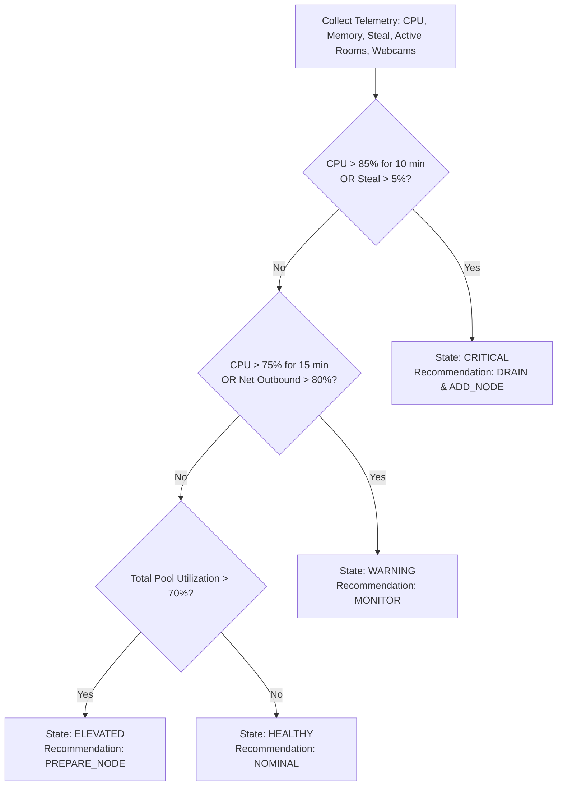

# Aeorax Live — Capacity Planning & Smart Advisor

**Scope**: BigBlueButton sizing formulas, concurrency limits, video bandwidth economics, and capacity heuristics.  
**Reference Date**: 2026-10-18  

---

## 1. BigBlueButton Hardware Sizing Heuristics

BigBlueButton meeting node resource consumption is primarily driven by **active webcams** and **audio packet transcoding**, rather than passive text listeners.

### The Math of Video Streams:
In a room with $N$ total participants where $W$ participants have their webcams active:
- FreeSWITCH / Kurento / mediasoup receives $W$ incoming video streams.
- The server encodes and distributes $W \times (N - 1)$ outgoing video streams.

$$\text{Total Video Streams} = W \times (N - 1)$$

*Example*:
- In a class of 50 students where 25 turn on their webcams:
  $$\text{Outgoing Streams} = 25 \times 49 = 1,225 \text{ video streams}$$
- This requires substantial dedicated CPU cycles and ~150–200 Mbps outbound bandwidth for a single room.

---

## 2. Recommended Node Tiers & Operational Capacity

| Node Spec | Dedicated vCPU | RAM | Max Rooms (Small) | Max Students (Audio + Screen) | Max Students (20 Cams) | Recommended Role |
| :--- | :---: | :---: | :---: | :---: | :---: | :--- |
| **Node-Standard** | 8 vCPU | 16 GB | 8–10 rooms | ~200 | ~75 | Entry / General College Classrooms |
| **Node-Pro** | 16 vCPU | 32 GB | 15–20 rooms | ~400 | ~150 | High-concurrency Peak Hours |
| **Node-Mega** | 32 vCPU | 64 GB | 30+ rooms | ~800 | ~300 | Multi-College Shared Pool Anchor |

---

## 3. Smart Capacity Advisor Logic

The Aeorax Telemetry Worker computes a real-time health score per node every 60 seconds based on Prometheus scrapes:

